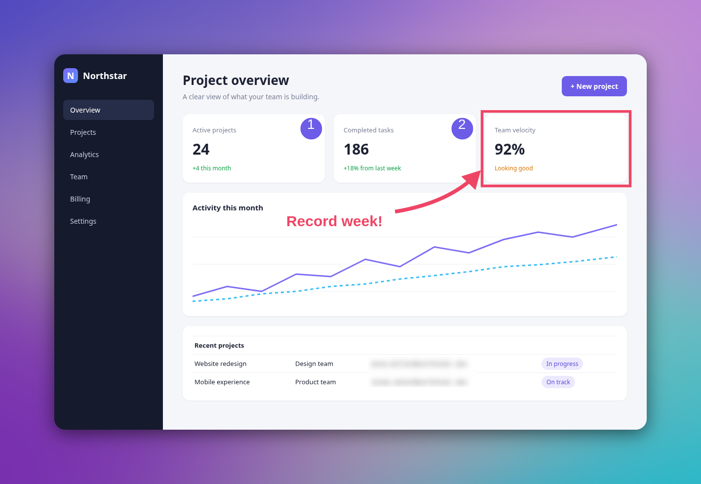
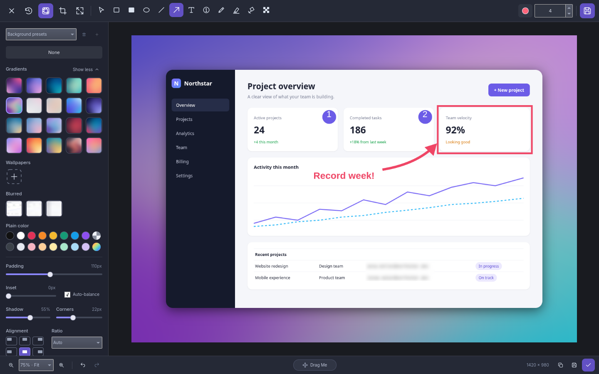
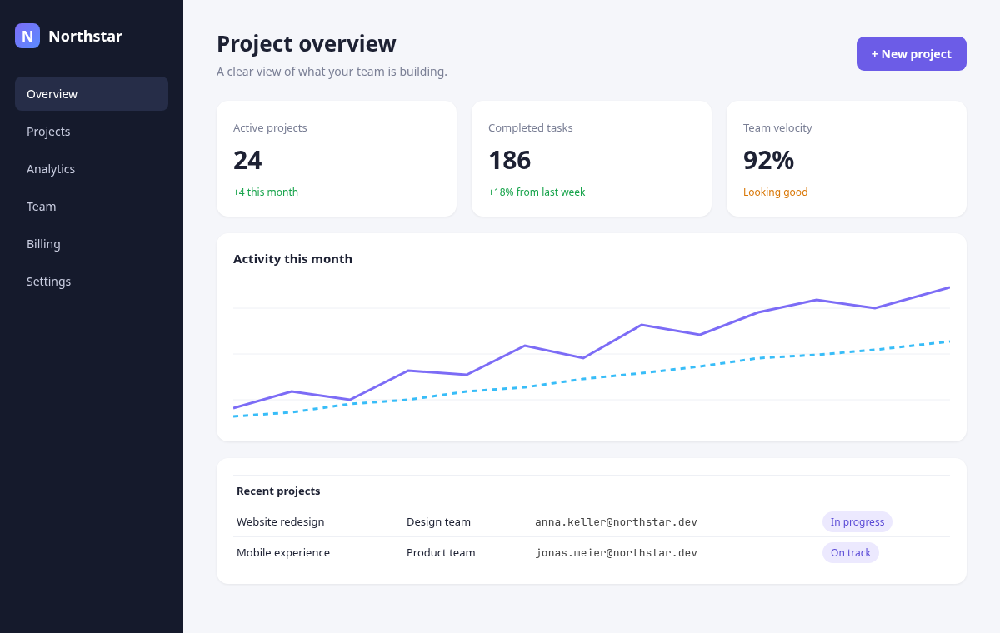
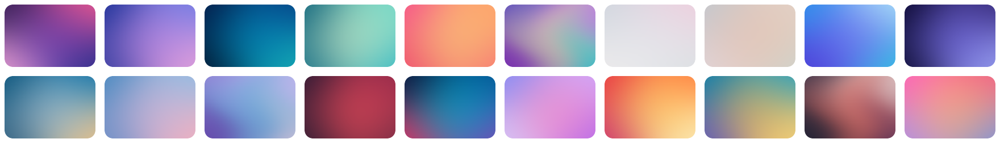
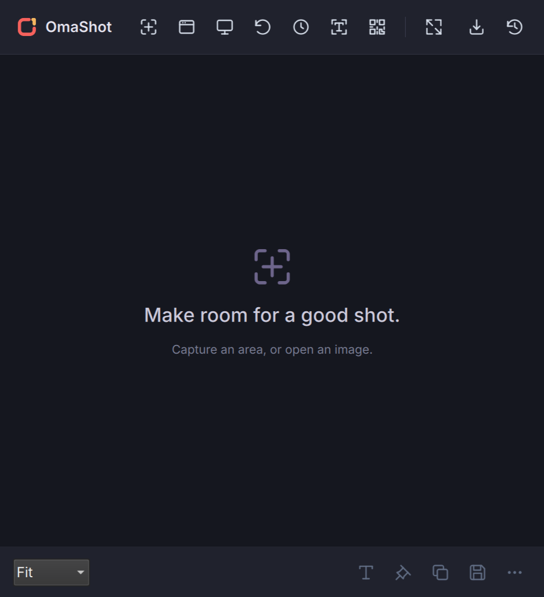

<div align="center">

<picture>
  <source media="(prefers-color-scheme: dark)" srcset="plugin/assets/brand/omashot-logo-light.svg">
  
</picture>

**Capture, annotate and style screenshots on [Omarchy](https://omarchy.org).**

Area, window and scrolling capture · annotation editor · beautiful backgrounds · pins · OCR & QR · self-cleaning history

[](https://github.com/hedingerm/omashot/actions/workflows/ci.yml)
[](LICENSE)


<br>



</div>

<br>

OmaShot is a native screenshot tool for Omarchy, built as an Omarchy shell plugin with Quickshell and a small Rust backend. Everything runs locally: no account, no upload, no telemetry.

## Contents

- [Features](#features)
- [Installation](#installation)
- [Usage](#usage)
- [Configuration](#configuration)
- [Development](#development)
- [Known limitations](#known-limitations)
- [Contributing](#contributing)
- [License](#license)

## Features

<table>
<tr>
<td width="50%" valign="top">

### 📸 Capture
- **Area, window, active window, fullscreen** and **repeat last area**
- Frozen-desktop selection with crosshairs, magnifier and live size
- **Scrolling capture**, vertical or horizontal, with a live preview
- **Isolated window capture** with real transparency
- Optional delay and cursor; import existing PNG/JPEG/WebP

</td>
<td width="50%" valign="top">

### ✏️ Annotate
- Straight and curved arrows, lines, shapes, text presets
- Numbered steps, pencil, highlighter, spotlight
- **Blur, pixelate and redact** sensitive content
- Crop, rotate, flip and combine images
- Every mark stays editable: select, move, resize, undo/redo

</td>
</tr>
<tr>
<td width="50%" valign="top">

### 🎨 Style
- **Twenty original gradient backgrounds**, wallpapers, blur and plain colors
- Padding, inset, shadow, corner radius and alignment
- Aspect ratios and auto-balance
- Save your favorite look as a reusable preset

</td>
<td width="50%" valign="top">

### ⚡ Workflow
- Quick-access thumbnails: copy, save, edit, pin or drag away
- **Pins** float above your windows with opacity and click-through
- Local **OCR** (Tesseract) and **QR** decoding straight to the clipboard
- **History** that expires after a configurable number of days

</td>
</tr>
</table>

### The editor

Icon-first toolbar on top, background styles on the side, zoom, copy, export and save in the footer.



### Before and after

| Raw capture | Styled with OmaShot |
|:---:|:---:|
|  |  |

### Twenty original backgrounds

Rendered by the same engine that produces your exports, so what you see is what you get.



### A launcher that stays out of the way



## Installation

### Requirements

- [Omarchy](https://omarchy.org) (Hyprland + Quickshell)
- `grim`, `slurp`, `wl-clipboard`, ImageMagick, Tesseract with language data, `zbar`, Python 3
- Rust (stable) to build the backend

On Omarchy/Arch:

```bash
sudo pacman -S --needed grim slurp wl-clipboard imagemagick tesseract tesseract-data-eng zbar python rust
```

### Install

```bash
git clone https://github.com/hedingerm/omashot.git
cd omashot
./scripts/doctor.sh     # checks dependencies
./scripts/install.sh    # builds and installs, no root needed
omashot-ui
```

The installer builds the release binary, puts `omashot` and `omashot-ui` in `~/.local/bin` (make sure it's on your `PATH`), installs the plugin into `~/.config/omarchy/plugins/omashot`, adds a desktop launcher and icons, and registers the plugin in `shell.json` (backing it up first).

> [!NOTE]
> OmaShot ships a native backend, so install it with `scripts/install.sh` rather than `omarchy plugin add`. To use a prebuilt binary, run `./scripts/install.sh --binary PATH`.

### Update and uninstall

```bash
git pull && ./scripts/install.sh   # update
./scripts/uninstall.sh             # uninstall (keeps captures, wallpapers and settings)
```

Updates keep your other shell settings and refuse to overwrite installed files you edited by hand.

## Usage

Open the launcher with `omashot-ui`, or go straight to a mode:

| Command | What it does |
|---|---|
| `omashot-ui region` | Select an area |
| `omashot-ui window` | Pick a window |
| `omashot-ui active` | Capture the focused window |
| `omashot-ui fullscreen` | Capture the whole screen |
| `omashot-ui repeat` | Capture the last area again |
| `omashot-ui history` | Browse previous captures |
| `omashot-ui ocr` | Select an area and copy its text |
| `omashot-ui qr` | Select an area and copy the decoded QR code |

### Keybindings

Bind any command through Omarchy's keybinding config, for example in `~/.config/hypr/bindings.lua`:

```lua
o.bind("SUPER + ALT + S", "OmaShot area", "omashot-ui region")
o.bind("SUPER + ALT + H", "OmaShot history", "omashot-ui history")
```

Pick chords that aren't taken yet (replacing one requires `hl.unbind(...)`), then check with `hyprctl reload` and `hyprctl configerrors`. Installing OmaShot doesn't touch your existing screenshot bindings.

### Tips

<details>
<summary><b>Capturing</b></summary>

- In area selection, drag to select, adjust the handles, then press <kbd>Enter</kbd>. <kbd>Esc</kbd> cancels.
- Turn off desktop freezing in Preferences to use `slurp` instead.
- Enable isolated window capture to export the window's own buffer with transparency (PNG/WebP).
- New captures appear as quick-access thumbnails. Hover for copy/save and more, or drag one into another app.

</details>

<details>
<summary><b>Editing</b></summary>

- Use **Select** to move or resize marks; arrows have endpoint and curvature handles. Double-click text to edit it.
- <kbd>Ctrl</kbd>+<kbd>Z</kbd> / <kbd>Ctrl</kbd>+<kbd>Shift</kbd>+<kbd>Z</kbd> undo and redo, <kbd>Delete</kbd> removes the selection, <kbd>Ctrl</kbd>+<kbd>S</kbd> saves to history.
- Drag another image onto the canvas to combine captures.
- Saved captures stay editable. Reopen them from history at any time.

</details>

<details>
<summary><b>Scrolling capture</b></summary>

Select the scrolling part of the window and press Start, then scroll normally. Frames are stitched as you go and a preview grows beside the selection. Keep some overlap between scroll steps. Sticky headers and animations can confuse stitching, so a smaller selection usually helps. Horizontal mode handles side-scrolling content.

</details>

<details>
<summary><b>Pins, OCR and QR</b></summary>

- Pins float above normal windows. Hover to move, resize, change opacity or make them click-through.
- OCR and QR run locally and copy the result. Pick the OCR language in Preferences (requires the matching `tesseract-data-*` package).

</details>

> [!IMPORTANT]
> Editable originals keep the pixels under blur and redaction so you can undo them. Share **exported** images, not project files.

### IPC

The running shell also accepts commands directly:

```bash
omarchy-shell shell summon omashot '{}'
omarchy-shell omashot capture region
omarchy-shell omashot history
```

## Configuration

Most settings live in the Preferences panel. Under the hood:

| Path | Contents |
|---|---|
| `~/.local/share/omashot/` | Captures, editable projects, wallpapers (`$XDG_DATA_HOME`) |
| `~/.config/omashot/config.json` | Preferences (`$XDG_CONFIG_HOME`) |

`omashot config` prints the current configuration; `omashot config '<json>'` replaces it, so keep existing keys when scripting.

**History retention:** captures are deleted after 30 days by default (`0` keeps them forever). Cleanup runs at shell startup, hourly, and on demand with `omashot cleanup`. Exported files and imported wallpapers are never deleted.

**Desktop icons:** if you use a desktop-icon provider, set `hide_desktop_icons: true` with `desktop_hide_argv` and `desktop_restore_argv` command arrays to hide icons while capturing. Commands run directly, without a shell.

## Development

```bash
cargo build
OMASHOT_BACKEND="$PWD/target/debug/omashot" qs -p plugin
qs ipc -p plugin call omashot open   # from another terminal
```

Checks:

```bash
cargo fmt --check
cargo clippy --all-targets -- -D warnings
cargo test --locked
bash tests/install.sh
omarchy plugin validate ./plugin
```

The `tests/` folder also has headless render and editor tests plus live Wayland smoke tests (which open real windows and overwrite your clipboard). [CONTRIBUTING.md](CONTRIBUTING.md) explains when to run which, and [AGENTS.md](AGENTS.md) maps the codebase.

<details>
<summary><b>Project layout</b></summary>

```
src/        Rust backend: capture, rendering, history, OCR/QR, scrolling
plugin/     Quickshell/QML Omarchy plugin (launcher, editor, backgrounds, pins)
scripts/    installer, uninstaller, launcher, brand asset generator
tests/      integration and smoke tests
packaging/  desktop entry
```

</details>

## Known limitations

- Scrolling capture follows your manual scrolling; it doesn't scroll the app for you.
- Marks drawn before a crop, resize or rotation stay in the project, but you need to undo the transform to edit their handles.
- No crop edge snapping or screen color picker yet.
- OCR needs installed Tesseract language data.
- Tested on a single monitor; unusual multi-monitor layouts may need fixes.

## Contributing

Bug reports, ideas and pull requests are welcome. Please read [CONTRIBUTING.md](CONTRIBUTING.md) first, and report security issues privately as described in [SECURITY.md](SECURITY.md).

## License

[MIT](LICENSE) © Manuel Hedinger. The OmaShot name and logo are original work; see the [brand guide](plugin/assets/brand/README.md).

OmaShot is an independent project and is not affiliated with Omarchy, Basecamp or 37signals.
